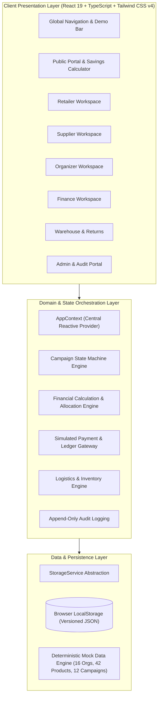
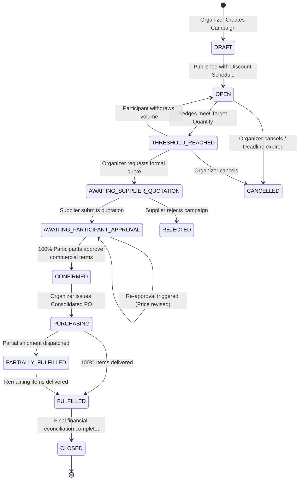
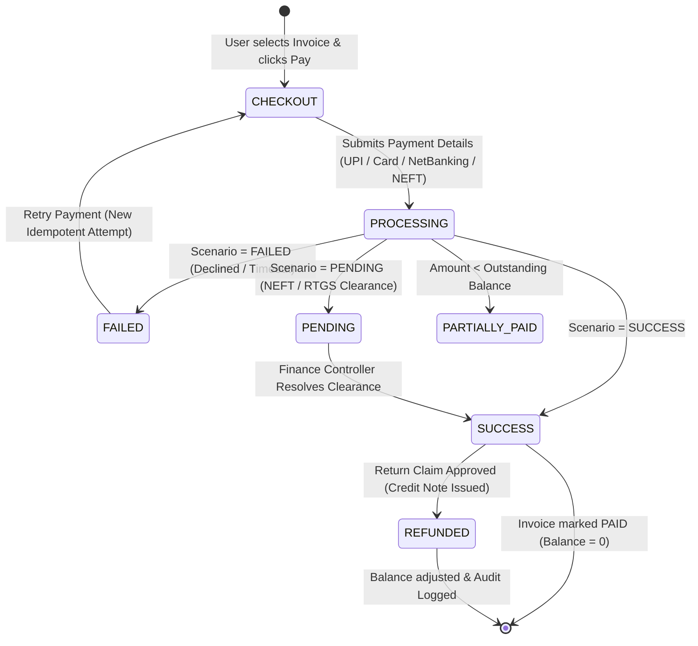

# BulkBridge — Technical Architecture & Engineering Specifications

## 1. System Overview & Architectural Principles

BulkBridge is architected as an enterprise-grade multi-tenant B2B collaborative commerce platform. It addresses the fundamental collective action problem faced by small and medium-sized independent enterprises: **how to combine purchasing volume to access wholesale factory pricing without merging balance sheets or sacrificing trade secrets**.

---

## 2. Campaign State Machine Architecture

BulkBridge implements a deterministic finite state machine (FSM) governing all bulk purchasing campaigns. State transitions are strictly validated and prevent illegal bypasses (e.g., jumping from `OPEN` straight to `PURCHASING`).

### Complete State Transition Graph

### State Definitions & Guards

| State | Permitted Actions | Validation Guards & Triggers |
| :--- | :--- | :--- |
| `DRAFT` | Edit SKU, define tiers, set deadline | Allowed only by Organizer. |
| `OPEN` | Retailers pledge or withdraw demand | Automatically evaluates aggregated volume against tiers. |
| `THRESHOLD_REACHED` | Supplier quotation can be requested | Evaluated dynamically: drops back to `OPEN` if a retailer withdraws. |
| `AWAITING_SUPPLIER_QUOTATION` | Supplier submits unit price, freight, & terms | Only the assigned Supplier can submit quotation records. |
| `AWAITING_PARTICIPANT_APPROVAL` | Retailers inspect itemized allocations and approve | Any upward price revision resets all participant approval flags to `false`. |
| `CONFIRMED` | Organizer prepares Consolidated PO | Cannot transition unless **every** participating retailer has approved. |
| `PURCHASING` | Consolidated PO issued, micro invoices generated | Commercial terms are locked. Terms cannot be mutated. |
| `PARTIALLY_FULFILLED` | Warehouse records partial dispatch | Shipment items track ordered vs dispatched vs delivered quantities. |
| `FULFILLED` | Warehouse logs delivery confirmation | Inventory movements logged; invoices reconciled. |
| `CLOSED` | Finance closes ledger | Terminal state. Zero residual verified across all participant accounts. |

---

## 3. Financial Calculation & Zero-Residual Allocation Engine

### The Problem of Floating-Point Drift
In multi-participant commercial billing, applying percentage discounts and tax rates using standard IEEE 754 floating-point numbers generates fractional-cent residuals (e.g., `0.3333...`). Across multiple buyers and line items, rounding drift creates discrepancies between the supplier's consolidated purchase order and the sum of participant invoices.

### BulkBridge Architectural Solution
BulkBridge eliminates rounding drift through two core engineering decisions:
1. **Integer Arithmetic in Paise:** All monetary values in the application domain are strictly modeled as integer paise (`1 INR = 100 paise`).
2. **Deterministic Macro-to-Micro Allocation with Zero-Residual Assignment:** The engine calculates the macro totals first, distributes proportional shares to each participant, and deterministically allocates any 1-paisa rounding residual to the participant with the largest volume share.

### Mathematical Formulation

Given:
- $N$ participants, where participant $i$ has pledged quantity $q_i$ at unit base price $p$.
- Total quantity $Q = \sum_{i=1}^N q_i$.
- Base subtotal $S_{\text{base}} = Q \times p$.
- Unlocked discount percent $d\%$.
- Total supplier discount $D_{\text{total}} = \text{round}\left(\frac{S_{\text{base}} \times d}{100}\right)$.
- Shared consolidated shipping charge $F_{\text{total}}$.
- Applicable GST rate $t\%$.

#### 1. Participant Proportional Discount Allocation:
For participant $i$, the preliminary discount is:
$$D_i = \text{floor}\left( \frac{q_i}{Q} \times D_{\text{total}} \right)$$

Residual discount paisa difference:
$$\Delta D = D_{\text{total}} - \sum_{i=1}^N D_i$$
$\Delta D$ is deterministically assigned to $\text{argmax}_{i}(q_i)$.

#### 2. Participant Taxable Base:
$$B_i = (q_i \times p) - D_i$$

#### 3. Proportional Freight Allocation:
$$F_i = \text{floor}\left( \frac{q_i}{Q} \times F_{\text{total}} \right)$$
Residual freight $\Delta F = F_{\text{total}} - \sum_{i=1}^N F_i$ is assigned to $\text{argmax}_{i}(q_i)$.

#### 4. Illustrative GST Breakdown:
- **Intra-State (Karnataka to Karnataka):**
  $$\text{CGST}_i = \text{round}\left( \frac{B_i \times (t/2)}{100} \right)$$
  $$\text{SGST}_i = \text{round}\left( \frac{B_i \times t}{100} \right) - \text{CGST}_i$$
  $$\text{IGST}_i = 0$$
- **Inter-State:**
  $$\text{IGST}_i = \text{round}\left( \frac{B_i \times t}{100} \right)$$
  $$\text{CGST}_i = 0, \quad \text{SGST}_i = 0$$

#### 5. Participant Final Payable:
$$P_i = B_i + F_i + \text{CGST}_i + \text{SGST}_i + \text{IGST}_i$$

#### 6. Mathematical Reconciliation Invariant:
$$\sum_{i=1}^N P_i \equiv \text{Macro Grand Total}_{\text{PO}} \quad (\text{Discrepancy} \equiv 0\text{ paise})$$

---

## 4. Privacy-Preserving Collaborative Architecture

A primary business friction in cooperative purchasing is competitor intelligence: retailers do not want rival neighborhood shops to see their order volumes, financial terms, or margins.

BulkBridge solves this with an **isolated perspective model**:
- **Consolidated Demand Metric:** All group members see total aggregate units (e.g., `100 cartons`) and progress towards discount tiers.
- **Competitor Masking:** When Retailer A views the campaign participants table:
  - Retailer A's own pledge is unmasked with full operational controls (`GreenMart Retail — 20 cartons — [Withdraw]`).
  - Other participants' identities are systematically masked as:
    - `Cooperative Participant #2 (Mysuru, Karnataka) — 35 cartons`
    - `Cooperative Participant #3 (Bengaluru, Karnataka) — 45 cartons`
- **Supplier Isolation:** Suppliers only see consolidated orders or authorized shipping addresses for their own products. A supplier has zero access to quotes, catalogs, or margins of competing suppliers.

---

## 5. Simulated Financial Rails & Payment State Architecture

BulkBridge models realistic enterprise B2B payment workflows with simulated gateways:

### Safety & Idempotency Controls
- **Idempotency Keys:** Every checkout submission generates a unique UUID-based idempotency key. Duplicate submissions with identical keys are rejected.
- **Overpayment Prevention:** The engine validates `amountPaise <= invoice.outstandingBalancePaise`. Any attempted overpayment is rejected by the transaction validator.
- **Non-Destructive Retries:** When a payment fails, the failed attempt is preserved as an immutable ledger record (`status: FAILED`, `failureReason: INSUFFICIENT_FUNDS_SIMULATED`). The retry creates a distinct child transaction without rewriting history.

---

## 6. Persistence & Storage Architecture

The demonstration utilizes a high-reliability service abstraction layer (`storageService.ts`):
- **Versioned Keys:** Stored under `bulkbridge_demo_state_v1.0` in browser `localStorage`.
- **Automatic Seed Bootstrapping:** If storage is uninitialized or corrupted, the service automatically loads the factory seed dataset.
- **One-Click Factory Reset:** Clears storage and restores pristine initial demonstration records without requiring a hard browser refresh.
- **Clean Service Boundary:** React components never read or write directly to browser storage; all mutations flow through `AppContext` actions, making future migration to REST/GraphQL APIs seamless.

---

## 7. Scalability & Production Migration Path

While this demonstration runs client-side for rapid evaluation, the domain architecture is designed for direct migration to a cloud-native production stack:

| Component | Demonstration Implementation | Production Cloud Architecture |
| :--- | :--- | :--- |
| **Database** | Versioned browser storage | **PostgreSQL 16** with Row-Level Security (RLS) |
| **API Layer** | In-memory `AppContext` actions | **NestJS / Go** microservices with GraphQL/REST |
| **Authentication** | Client-side role switcher | **Auth0 / AWS Cognito** with JWTs and multi-factor auth |
| **Financial Ledgers** | Deterministic TypeScript engine | **Double-entry bookkeeping ledger** with append-only SQL tables |
| **Payment Rails** | Simulated UPI/Card/NEFT engine | **RazorpayX / Cashfree / Stripe** webhooks with Escrow accounts |
| **E-Invoicing** | Interactive printable HTML template | **NIC GST Portal API** with signed QR codes & IRNs |
| **Audit Logging** | In-memory reactive array | **AWS CloudTrail / Kafka** streaming to immutable S3 storage |
| **Containerization** | Local Vite Dev Server | **Docker + Kubernetes** on AWS/GCP with Cloudflare CDN |
