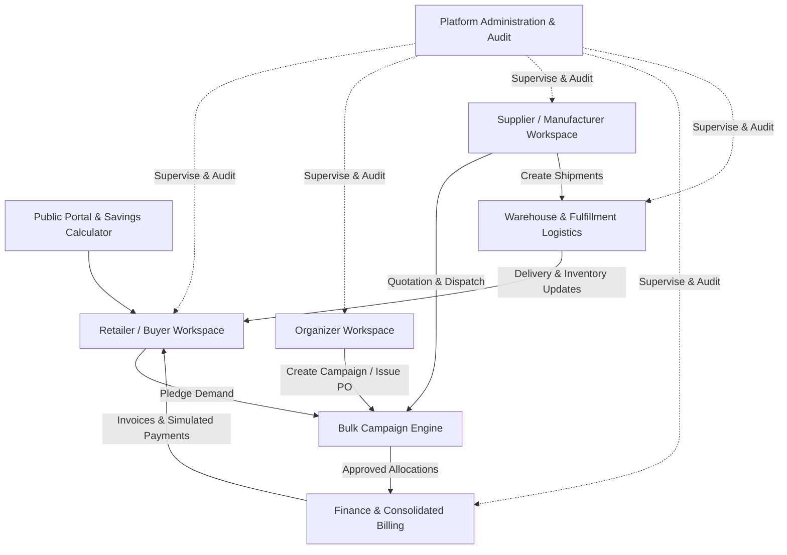

# BulkBridge
**Enterprise-Grade Collaborative Bulk Purchasing, Smart Billing & Supplier Marketplace**

> **Tagline:** *Buy Together. Save More. Grow Faster.*  
> **Market Context:** Tailored for the Indian B2B Commerce Ecosystem (INR ₹, GSTIN compliance models, multi-tier logistics, and purchasing cooperatives).

---

## 1. Executive Summary

BulkBridge is a high-performance B2B procurement and cooperative purchasing platform. It enables independent retailers, wholesalers, and small-to-medium businesses to aggregate individual purchase demand into consolidated bulk orders. This unlocks enterprise-level supplier volume discounts without requiring participating businesses to merge ownership, share sensitive customer data, or take on joint credit liabilities.

### Core Value Pillars
- **Demand Aggregation Engine:** Dynamic volume tier tracking with real-time discount unlocking and transparent threshold visualization.
- **Financial Integrity & Zero Residuals:** Integer paise precision arithmetic with exact multi-participant shared cost and GST allocation, ensuring zero discrepancies between macro purchase orders and micro participant invoices.
- **Privacy-Preserving Collaboration:** Aggregate quantities are visible across buyer groups, but competitor identities and order specifics are anonymized to protect business confidentiality.
- **Simulated Financial Rails:** Full interactive simulation of UPI, Debit/Credit Cards, Net Banking, and NEFT/RTGS with idempotent transaction handling, partial payments, and dispute resolution.
- **End-to-End Fulfillment & Logistics:** Perpetual inventory movements ledger, carrier assignment, real-time shipment milestone progression, and return/credit-note processing.

---

## 2. Quick Start & Startup Commands

### Prerequisites
- **Node.js**: v18.0.0 or higher (v20+ / v24 recommended)
- **Package Manager**: `npm` (v9+ / v11+)

### Installation
```bash
# Clone or navigate to the repository directory
cd "c:\Users\manue\OneDrive\Desktop\Bulk bridge"

# Install all project dependencies
npm install
```

### Running Locally (Development Server)
```bash
# Start Vite development server
npm run dev

# Or specify a fixed port:
npx vite --port 5173
```
Open **[http://localhost:5173/](http://localhost:5173/)** in any modern web browser.

### Running Automated Test Suite
```bash
# Run all Vitest unit and integration tests (single run)
npx vitest run

# Run tests in watch mode
npx vitest
```

### Production Build & Type Checking
```bash
# Build the minified production bundle with full TypeScript checking
npm run build

# Preview the production build locally
npm run preview
```

---

## 3. Technology Stack

| Layer | Technology | Rationale |
| :--- | :--- | :--- |
| **Frontend Framework** | **React 19** with **TypeScript** | Type-safe enterprise UI architecture with modern component state and lifecycle hooks. |
| **Build Tool** | **Vite 8** (`@tailwindcss/vite`) | Sub-millisecond HMR, lightning-fast bundler, and zero-config TypeScript compilation. |
| **Styling & Design System** | **Tailwind CSS v4** & Vanilla CSS | Curated enterprise design tokens: deep charcoal `#0B132B`, slate cards, emerald `#10B981` savings accents, and amber warnings. |
| **Icons** | **Lucide React** | Clean, consistent, lightweight SVG iconography across all 7 workspace dashboards. |
| **Testing** | **Vitest 5** | High-velocity test runner for domain state machines, zero-residual financial logic, and scenario integration. |
| **Persistence** | **LocalStorage Service Abstraction** | Versioned browser storage with initial factory seed auto-load and 1-click demo state reset. |

---

## 4. The Seven Connected Workspaces

BulkBridge provides an integrated multi-tenant experience where actions taken in one workspace instantly reflect across all other relevant dashboards:



1. **Public Website & Onboarding**: Hero value proposition, interactive savings estimator, cooperative purchasing mechanics, retailer and supplier value guides, and FAQ.
2. **Retailer & Buyer Workspace**: Browse catalog, commit demand to campaigns, monitor discount tiers, approve quotations, track individual orders, pay invoices via simulated payment gateway, and initiate return claims.
3. **Supplier & Manufacturer Workspace**: Product SKU catalog management, campaign quotation submission, terms revisions, purchase order acceptance, shipment tracking creation, and receivables tracking.
4. **Organizer & Purchasing Coordinator Workspace**: Campaign creation wizard (4-step), supplier comparison matrix (landed cost vs lead time), threshold management, participant notification dispatch, and exception handling.
5. **Finance & Accounting Workspace**: Consolidated ledger, micro-invoice registers, payment audit trail, refund processing, and exact 0-paise reconciliation validation between consolidated POs and participant payments.
6. **Warehouse, Fulfillment & Returns Workspace**: Picking, packing, and dispatch progression, carrier tracking assignment, perpetual inventory movements ledger, damage inspection, and credit note issuance.
7. **Platform Administration & Auditor Workspace**: Organization verification queue, user directory, system configuration, audit logging, and aggregate analytics visualizations.

---

## 5. Predefined Demo Accounts

The top demo banner features a quick-login role switcher. You can immediately switch between any of the following 7 roles with a single click:

| Role | Email | Name & Organization | Key Focus Area |
| :--- | :--- | :--- | :--- |
| **Platform Administrator** | `admin@bulkbridge.demo` | Vikram Malhotra (BulkBridge HQ) | Verification, org configuration, global audit logs |
| **Retail Shop Owner** | `buyer@bulkbridge.demo` | Rajesh Kumar (GreenMart Retail) | Catalog browsing, campaign pledging, invoice payment |
| **Group Purchasing Lead** | `organizer@bulkbridge.demo` | Priya Sharma (Karnataka Retailers Coop) | Campaign creation, supplier quotations, PO generation |
| **Supplier / Manufacturer** | `supplier@bulkbridge.demo` | Suresh Patel (Apex Lumens & Lighting) | Quotation submission, order acceptance, dispatch |
| **Finance Controller** | `finance@bulkbridge.demo` | Ananya Rao (BulkBridge Finance) | 0-paise reconciliation, payment logs, refund approval |
| **Warehouse Operator** | `warehouse@bulkbridge.demo` | Ramesh Verma (Central Hub Logistics) | Manifests, shipment milestones, inventory ledger |
| **Read-Only Auditor** | `auditor@bulkbridge.demo` | Devendra Joshi (Compliance Auditor) | Tamper-evident append-only audit trail inspection |

*Password: All demo accounts use the standard demo password `DemoUser2026!` (pre-authenticated in browser storage).*

---

## 6. Canonical 21-Step User Journey

BulkBridge includes an automated interactive runner for the canonical demonstration scenario: **3 independent retailers combining demand for 100 cartons of 9W commercial LED bulbs to unlock the 8% wholesale volume tier**.

Click **"21-Step Guide"** in the top navigation bar to launch the modal and execute each step automatically or follow the guided instructions:

1. **Step 1:** Log in as Purchasing Organizer (Priya Sharma).
2. **Step 2:** Open the 9W Commercial LED Bulb campaign (`CMP-2026-001`).
3. **Step 3:** Switch to Retailer A (GreenMart) and inspect their 20-carton pledge (0% tier).
4. **Step 4:** Switch to Retailer B (Sri Lakshmi Stores) and inspect their 35-carton pledge (unlocks 5% tier at 55 units).
5. **Step 5:** Switch to Retailer C (Metro Home Supplies) and pledge 45 cartons.
6. **Step 6:** Verify combined volume reaches **100 cartons** and status transitions to `THRESHOLD_REACHED`.
7. **Step 7:** Verify the **8% volume discount tier** is automatically unlocked.
8. **Step 8:** Switch to Supplier (Apex Lumens) and submit quotation with delivery terms.
9. **Step 9:** Switch to Organizer and generate Consolidated Purchase Order `PO-2026-9001`.
10. **Step 10:** Review and approve proportional allocations across all 3 participating retailers.
11. **Step 11:** Generate individual itemized GST invoices for each participant.
12. **Step 12:** Retailer A completes simulated payment via **UPI** (instant success, balance → ₹0).
13. **Step 13:** Retailer B simulates a failed payment attempt (Card decline), then retries via **NEFT** and succeeds.
14. **Step 14:** Retailer C initiates an offline bank transfer (status `PENDING`), resolved via demo reconciliation control.
15. **Step 15:** Confirm all invoice balances update and duplicate payment attempts are blocked.
16. **Step 16:** Switch to Warehouse Operator and begin picking/packing.
17. **Step 17:** Dispatch consolidated shipment via carrier (VRL Logistics tracking `VRL-BLR-998822`).
18. **Step 18:** Mark shipment delivered and log delivery timestamps.
19. **Step 19:** Inspect perpetual inventory movements ledger (100 units deducted, audit recorded).
20. **Step 20:** Open Finance Workspace: confirm **0.00 paise residual discrepancy** between macro PO and micro invoices.
21. **Step 21:** Open Audit Log: inspect complete, append-only history of every state transition.

---

## 7. Deterministic Mock Seed Dataset

The application initializes with rich, relational seed data:
- **16 Fictional Organizations:** 8 retail stores, 6 certified manufacturers, 1 purchasing cooperative, 1 platform entity.
- **42 Catalog Products:** Across 8 commercial categories (FMCG, Electrical, Agricultural Supplies, Textiles, Packaging, Office Supplies, Hardware, Electronics).
- **12 Bulk Campaigns:** Across diverse lifecycles (Open, Threshold Reached, Awaiting Quotation, Awaiting Approval, Purchasing, Fulfilled, Closed).
- **30 Purchase Orders & Invoices:** Itemized with CGST/SGST/IGST breakdowns.
- **20 Payment Records:** Covering SUCCESS, FAILED, PENDING, and PARTIALLY_PAID states.
- **Perpetual Inventory Ledger:** Detailed stock tracking with movement reason codes.
- **Tamper-Evident Audit Trail:** Detailed records capturing actor, action, previous state, new state, and timestamp.

---

## 8. Documentation Sitemap

- [Architecture Design Document](file:///c:/Users/manue/OneDrive/Desktop/Bulk%20bridge/ARCHITECTURE.md): Comprehensive system architecture, state machines, financial calculation algorithms, and storage strategy.
- [Business Workflows Guide](file:///c:/Users/manue/OneDrive/Desktop/Bulk%20bridge/WORKFLOWS.md): Detailed operational workflows for all 7 platform workspaces.
- [Demo Walkthrough & Scenario Guide](file:///c:/Users/manue/OneDrive/Desktop/Bulk%20bridge/DEMO_GUIDE.md): Step-by-step instructions for live presentations and stakeholder reviews.
- [Security & Limitations Disclosures](file:///c:/Users/manue/OneDrive/Desktop/Bulk%20bridge/SECURITY_AND_LIMITATIONS.md): Formal disclosures regarding simulated payments, client-side role checks, and production requirements.
- [Final Implementation Report](file:///c:/Users/manue/OneDrive/Desktop/Bulk%20bridge/IMPLEMENTATION_REPORT.md): Build metrics, test execution verification, and feature coverage matrix.
