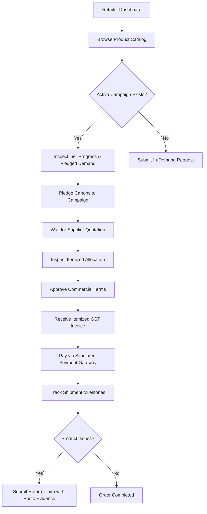
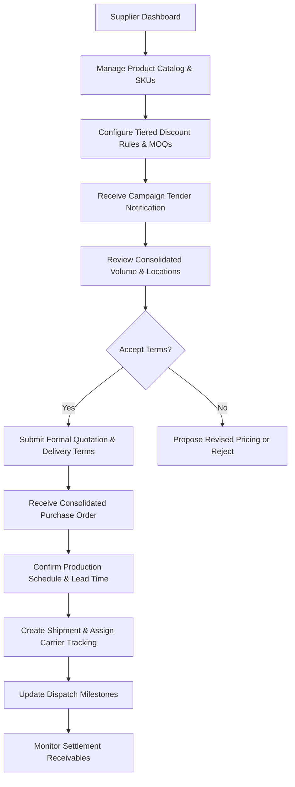
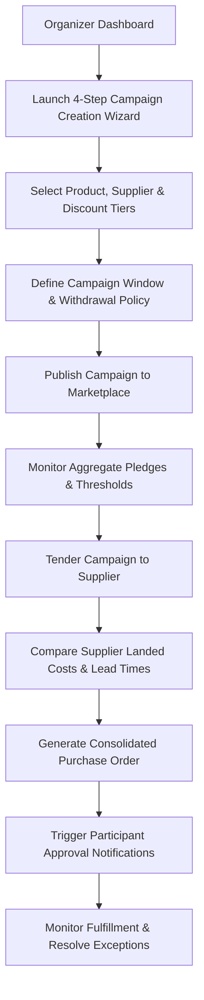
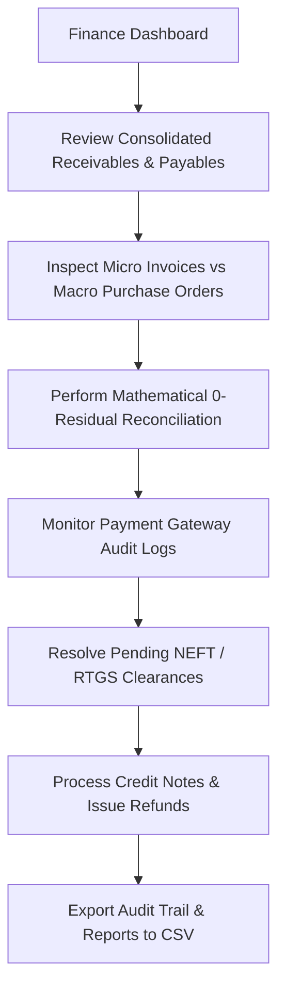
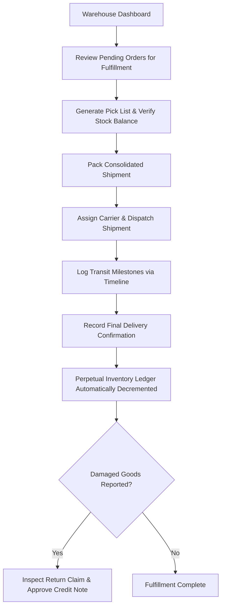
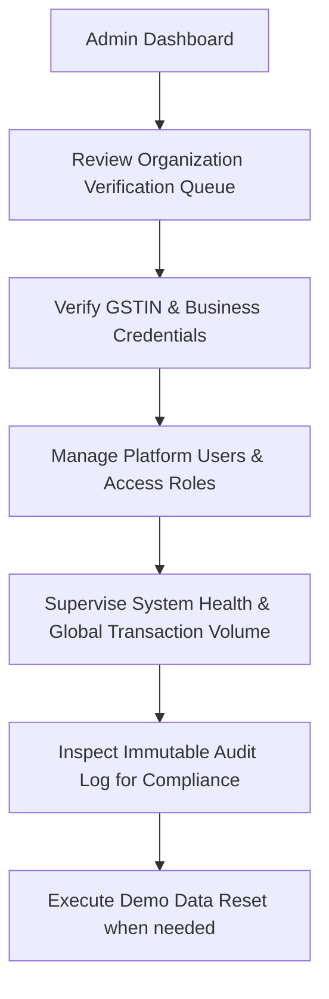

# BulkBridge — Business Workflows & Operational Handbook

This document outlines the operational journeys across all seven workspaces of the BulkBridge platform. Each workflow models real-world B2B commercial interactions within the Indian commerce and manufacturing ecosystem.

---

## 1. Public Website & Demand Exploration Workflow

### Key Capabilities & User Actions:
1. **Interactive Savings Estimator:** Visitors adjust order volume sliders to instantly see projected group savings compared to standard retail baseline pricing.
2. **Transparent Commercial Policy Explanation:** Discloses how volume aggregation works, how shared logistics costs are divided proportionally, and how business data is protected.
3. **Role-Based Demo Access Bar:** Located persistently across the top banner, allowing instantaneous role-switching to any of the 7 predefined demo accounts.

---

## 2. Retailer & Buyer Workspace Workflow

### Detailed Operational Procedures:
1. **Discovering Campaigns:**
   - Retailer views active campaigns with visual progress bars showing current tier, next tier threshold, and remaining quantity needed.
   - Competitor participants are masked to prevent leakage of sensitive business data.
2. **Pledging & Withdrawing:**
   - Retailer selects delivery location and inputs pledged units.
   - Pledges can be withdrawn or edited anytime prior to supplier quotation acceptance.
3. **Reviewing & Approving Allocations:**
   - Once a supplier accepts the consolidated demand, the retailer receives an itemized allocation breakdown showing their base cost, volume discount, allocated freight, and GST.
   - Retailer clicks **"Approve Allocation"** to lock in their commitment.
4. **Checkout & Payment:**
   - Clicking **"Pay Invoice"** opens the simulated checkout modal.
   - Retailer can choose UPI, Credit/Debit Card, Net Banking, or NEFT/RTGS.
   - Retailer can test successful payments, simulated card declines, or pending bank clearances.
5. **Returns & Credit Notes:**
   - If goods arrive damaged, the retailer clicks **"Report Damage / Return"** on the completed order.
   - Selects reason (`DAMAGED_IN_TRANSIT`, `DEFECTIVE_PRODUCT`, etc.) and quantity.
   - Warehouse approval automatically issues a Credit Note and triggers a simulated refund.

---

## 3. Supplier & Manufacturer Workspace Workflow

### Detailed Operational Procedures:
1. **SKU & Volume Tier Configuration:**
   - Supplier defines product specs, packaging dimensions, unit lead times, and discount schedules (e.g., 0% for 1–49 units, 5% for 50–99 units, 8% for 100–199 units, 12% for 200+ units).
2. **Quotation Submission:**
   - When a campaign reaches its volume threshold, the supplier reviews the aggregated volume and delivery requirements.
   - Supplier inputs unit price, freight charge, delivery terms (e.g., ex-works or delivered to regional hubs), and quotation validity period.
3. **Handling Revisions:**
   - If raw material costs fluctuate, the supplier can submit a revised quote with revision notes. The system automatically notifies all participants and resets approval flags.
4. **Order Fulfillment:**
   - Upon PO generation, the supplier creates a shipment record, enters carrier tracking details (e.g., VRL Logistics or BlueDart), and updates fulfillment milestones from `PICKING` to `PACKED` to `DISPATCHED`.

---

## 4. Organizer & Purchasing Coordinator Workflow

### Detailed Operational Procedures:
1. **Campaign Creation Wizard:**
   - **Step 1: Product & Supplier Selection:** Choose eligible SKUs and pre-negotiated wholesale suppliers.
   - **Step 2: Discount Tiers:** Configure volume thresholds and corresponding discount percentages.
   - **Step 3: Timeline & Policies:** Set campaign launch date, target deadline, and withdrawal cutoff.
   - **Step 4: Review & Publish:** Review terms and publish the campaign to the cooperative network.
2. **Supplier Comparison Matrix:**
   - Organizer compares multiple quotations using landed cost, lead time, and payment terms—not merely headline discount percentages.
3. **Consolidated PO Generation:**
   - When all participants approve terms, the organizer clicks **"Generate Consolidated PO"**.
   - The platform calculates the macro financial total and generates individual participant invoices automatically.

---

## 5. Finance & Accounting Workspace Workflow

### Detailed Operational Procedures:
1. **Zero-Residual Reconciliation:**
   - Finance verifies that the sum of all participant invoices exactly equals the consolidated supplier purchase order down to the exact paisa (`0.00 discrepancy`).
2. **Resolving Pending Payments:**
   - For high-value B2B transactions initiated via NEFT/RTGS with status `PENDING`, the finance controller can inspect the simulated UTR reference and click **"Mark Cleared / Reconciled"**.
   - This immediately transitions the payment to `SUCCESS` and updates the invoice balance to `0`.
3. **Refunds & Credit Notes:**
   - Returns approved by the warehouse appear in the Credit Note register. Finance clicks **"Issue Refund"** to execute a simulated refund transaction.
4. **Data Exports:**
   - 1-click CSV export of the complete invoice register, payment transactions, and reconciliation audit logs.

---

## 6. Warehouse, Freight & Returns Workflow

### Detailed Operational Procedures:
1. **Shipment Lifecycle:**
   - Transitions through `CONFIRMED` → `PICKING` → `PACKED` → `DISPATCHED` → `IN_TRANSIT` → `DELIVERED`.
2. **Perpetual Inventory Ledger:**
   - Every dispatch event logs an immutable entry in the inventory ledger with SKU, warehouse location, quantity change, ending balance, and actor.
   - Over-fulfillment and duplicate stock deductions are strictly prevented.
3. **Return Inspection & Credit Notes:**
   - Damaged items reported by buyers are reviewed by the warehouse operator. Clicking **"Approve Claim"** automatically generates a numbered Credit Note (`CRN-2026-XXX`) and updates inventory records.

---

## 7. Platform Administration & Audit Supervision Workflow

### Detailed Operational Procedures:
1. **Verification Queue:**
   - Admin reviews submitted KYC documents and GSTIN certificates for new retail buyers and manufacturing suppliers.
   - Admin can approve or request additional documentation.
2. **Audit Trail Inspection:**
   - Append-only event stream logging actor, action, previous state, new state, reason, and timestamp for all critical commercial operations.
   - Tamper-evident architecture suitable for compliance and audit review.
3. **One-Click Demo Reset:**
   - Admin can reset the entire platform state to the pristine factory seed dataset at any time.
